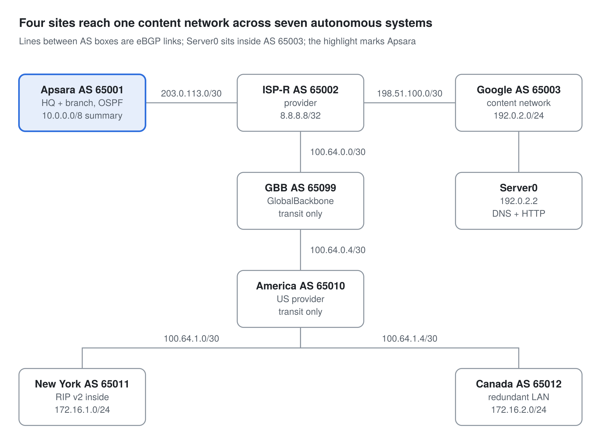

# Multi-Site Enterprise & Simple Internet Routing Lab (Packet Tracer)

Oct 14, 2026 · Bunthy

## Summary

| Area | Scope |
| --- | --- |
| Sites | PhnomPenh HQ, SiemReab Branch, New York, Canada |
| Autonomous systems | 7 ASNs (65001, 65002, 65003, 65010, 65011, 65012, 65099) |
| Routing | OSPF, RIPv2, eBGP (6 sessions) |
| Layer 2 | VLANs, 802.1Q trunks, Rapid PVST+, EtherChannel |
| Services | HTTP, DNS, DHCP and DHCP relay |
| Security | SSH, ACL isolation of HR department, port security |
| Testing | 16-point end-to-end checklist; measured failover on the Canada LAN |
| Troubleshooting | 17 faults documented with cause and fix |

## Topology

The Apsara Co.LTD HQ is connected to the ISP-R (the Branch reaches it through the HQ), and the ISP-R continues links to the content network role as the Google-Youtube. ISP-R also links to the Global Backbone (GBB), which leads to America, which links with New York and Canada.

## Design decisions

The core idea of the design was to waste as few addresses as possible, keep the infrastructure easy to recognize, and put each protocol and service where it fits best.

| Decision | Reasoning |
| --- | --- |
| VLSM, not flat /24 | Each Apsara department gets a /27, leaving five /27s free for growth; Canada's office gets cut into /26, /27 and /28 based on the expected number of users in the office. |
| /30 transit links | A point-to-point link needs two addresses, so every routed link between devices uses a /30 from a dedicated range (10.99.x.x in Apsara and 100.64.x.x between providers). |
| OSPF, RIP and eBGP | OSPF runs inside Apsara's network, RIPv2 runs inside New York, and eBGP carries routes between companies that don't automatically trust each other. |
| Isolation of the most sensitive department | HR is isolated from the others by an ACL, and its access ports are locked down with port security. |
| DNS and HTTP | The YouTube server is created in the role of a global internet site, with the IP 192.0.2.2 and the domain name youtube.com. |

## Addressing plan

### Address blocks by organization

| Organization | Block | Used for |
| --- | --- | --- |
| Apsara | 10.0.0.0/8 | Phnom Penh `10.10.0.0/24`, Siemreab `10.20.0.0/24`, infrastructure links `10.99.x.x/30` |
| New York | 172.16.1.0/24 | One flat LAN |
| Canada | 172.16.2.0/24 | Four VLANs, split by VLSM |
| Provider links | 100.64.0.0/10 | `/30` links between providers |
| Simulated internet | 203.0.113.0/24, 198.51.100.0/24, 192.0.2.0/24, 8.8.8.8/32 | Documentation ranges and the stand-in “internet” |
| Reserved, not built | 192.168.0.0/16 | London, if I add it |

### Apsara (Layer 3 switch SVIs are the gateways)

| VLAN | Name | Phnom Penh | Siemreab | Gateway | DHCP range |
| --- | --- | --- | --- | --- | --- |
| 10 | HR | 10.10.0.0/27 | 10.20.0.0/27 | .1 | .2 – .27 |
| 20 | Sale | 10.10.0.32/27 | 10.20.0.32/27 | .33 | .34 – .59 |
| 30 | Marketing | 10.10.0.64/27 | 10.20.0.64/27 | .65 | .66 – .91 |

The last three addresses of each /27 are excluded from DHCP for static devices. Each office’s `.96/27`, `.128/27`, `.160/27`, `.192/27` and `.224/27` are reserved for future departments.

### New York

| Network | Subnet | Gateway | DHCP range | DNS |
| --- | --- | --- | --- | --- |
| LAN | 172.16.1.0/24 | 172.16.1.1 | .2 – .249 | 192.0.2.2 |

### Canada (router subinterfaces are the gateways)

| VLAN | Name | Subnet | Gateway | DHCP range | Usable hosts |
| --- | --- | --- | --- | --- | --- |
| 10 | SALES | 172.16.2.0/26 | .1 | .10 – .62 | 62 |
| 20 | HR | 172.16.2.64/27 | .65 | .70 – .94 | 30 |
| 30 | GUEST | 172.16.2.96/28 | .97 | .99 – .110 | 14 |
| 50 | MGMT | 172.16.2.112/28 | .113 | none, static only | 14 |
| 99 | NATIVE | none | none | none | none |

Management IPs in VLAN 50 are CORE-SW `.114`, DIST-SW `.115`, SW-SALES `.116`, SW-HR `.117` and SW-GUEST `.118`. The range `172.16.2.128` to `.255` is free for growth.

### Every point-to-point link (/30)

| Link | Subnet | Side A | Side B |
| --- | --- | --- | --- |
| PhnomPenh_CoreSW to PhnomPenh_Router | 10.99.1.0/30 | .1 | .2 |
| SiemReab_CoreSW to SiemReab_Router | 10.99.2.0/30 | .1 | .2 |
| PhnomPenh_Router to SiemReab_Router (WAN) | 10.99.3.0/30 | PhnomPenh_Router .1 | SiemReab_Router .2 |
| PhnomPenh_Router to ISP-R | 203.0.113.0/30 | ISP-R .1 | PhnomPenh_Router .2 |
| ISP-R to Google_Router | 198.51.100.0/30 | ISP-R .1 | Google_Router .2 |
| ISP-R to GBB_ROUTER | 100.64.0.0/30 | ISP-R .1 | GBB .2 |
| GBB_ROUTER to America_Router | 100.64.0.4/30 | GBB .5 | America .6 |
| America_Router to NewYork_Router | 100.64.1.0/30 | America .1 | New York .2 |
| America_Router to CANADA-ROUTER | 100.64.1.4/30 | America .5 | Canada .6 |

Google_Router’s LAN is `192.0.2.0/24`, with the router at `.1` and Server0 at `.2`.

Each /30 uses its two middle addresses, never the first (network) or last (broadcast) address. That’s the rule behind my earlier “bad mask” error on `100.64.0.4`.

Each organization announces its own block over eBGP, so no two blocks may overlap. Together with the /30 links, that’s why the plan holds together.

## What I configured

### Apsara HQ and SiemReab Branch

Each office runs a 3560 Layer 3 switch that routes between three department VLANs and a 1941 router that handles the WAN, and OSPF area 0 joins the two sites.

Infrastructure links use 10.99.1.0/30 (PhnomPenh_CoreSW to PhnomPenh_Router), 10.99.2.0/30 (SiemReab_CoreSW to SiemReab_Router) and 10.99.3.0/30 (PhnomPenh_Router to SiemReab_Router, the WAN).

- **DHCP:** each core switch serves a pool per VLAN, with the last 3 addresses of every /27 excluded for static devices.
- **OSPF:** single area, manual router IDs (PhnomPenh_Router 1.1.1.1, SiemReab_Router 2.2.2.2, PhnomPenh_CoreSW 3.3.3.3, SiemReab_CoreSW 4.4.4.4) and default-information originate on PhnomPenh_Router so every device learns the route to the internet.
- **NAT/PAT:** translates all the 10.0.0.0/8 traffic out its serial link to the ISP and holds the static default route.
- **Hardware:** I added an HWIC-2T serial module to PhnomPenh_Router to connect to the ISP.
- **Security:** SSH-only management with RSA keys on all four core devices. An inbound ACL on each HR VLAN interface isolates HR from the other departments while leaving internet access open. HR ports also use sticky-MAC port security.

### Internet backbone with eBGP

A simulation of the internet linking the content network, Apsara Co., New York and Canada, with each company or site announcing only its own address space over eBGP.

| AS | Network | Role | Advertises |
| --- | --- | --- | --- |
| 65001 | Apsara (PhnomPenh_Router) | Customer | 10.0.0.0/8 summary, created with a Null0 route |
| 65002 | ISP-R | Provider for Apsara | 8.8.8.8/32 and the 203.0.113.0/30 link |
| 65003 | Google_Router | Content network | 192.0.2.0/24 (the server) |
| 65099 | GBB_ROUTER (GlobalBackbone) | Transit | Nothing of its own |
| 65010 | America_Router (AmeriCom) | US provider | Nothing of its own |
| 65011 | New York Co | Customer | 172.16.1.0/24 |
| 65012 | Canada Co | Customer | 172.16.2.0/24, created with a Null0 route |

Provider links use public-style or shared ranges: PhnomPenh_Router to ISP-R (203.0.113.2/30 to 203.0.113.1/30), ISP-R to Google_Router (198.51.100.1/30 to 198.51.100.2/30), ISP-R to GBB (100.64.0.1/30 to 100.64.0.2/30), GBB to America (100.64.0.5/30 to 100.64.0.6/30), America to New York (100.64.1.1/30 to 100.64.1.2/30) and America to Canada (100.64.1.5/30 to 100.64.1.6/30).

The content network hosts Server0 (YouTube's server) at 192.0.2.2. It runs DNS (youtube.com resolves to 192.0.2.2) and HTTP, serving a mock web page. The eBGP path from Apsara's site to Canada's site shows (65001→65002→65099→65010→65012) its hops from one neighbor to another.

**BGP note:**

- BGP advertises routes, not the actual data packets, so it only tells the router where networks are reachable, and the packets are forwarded later using the routing table.
- In Cisco IOS, the BGP network command only advertises the prefix if the exact matching prefix and mask already exist in the router's routing table.
- A company should originate its own prefix. Originating means introducing that network into BGP as a network this router's AS is announcing.
- BGP records the ASes a route passed through in its AS-PATH. Apsara learns about Canada's network from ISP-R, ISP-R learns it from GBB_ROUTER, GBB_ROUTER learns it from America_Router, and America_Router learns it from CANADA-Router. This forms an AS-PATH like 65002 65099 65010 65012.
- The end of the path must be advertised as well, otherwise there will be no route back.
- After config changes, run `clear ip bgp *` to flush stale entries.

### New York Co (RIP)

New York Co runs RIPv2 inside its office and originates its own 172.16.1.0/24 into BGP. A PC there opens the mock site (youtube.com) and pings PhnomPenh.

- **LAN:** New York Co uses 172.16.1.0/24 with the gateway 172.16.1.1. The DHCP pool is on the router, excludes the gateway and .250 to .254, and hands out the DNS server 192.0.2.2.
- **RIP:** version 2 with no auto-summary runs between NewYork_Router and America_Router. RIP's network command is classful, so 100.64.1.0 is treated as the whole 100.0.0.0/8 range.
- **BGP:** AS 65011 is a neighbor of America_Router (AS 65010) at 100.64.1.1 and advertises 172.16.1.0/24.

### Canada Co enterprise LAN

Canada is a redundant office LAN with 2 upstream switches and 3 access switches, a router-on-a-stick gateway, DHCP relay and an eBGP link to the rest of the networks in the lab. It also uses Rapid PVST+ with root bridges placed by VLAN.

#### Layer 2 design

- Every inter-switch link is an 802.1Q trunk with native VLAN 99 and allowed VLANs 10, 20, 30, 50 and 99. VTP is in transparent mode.
- All 3 access switches have two uplinks: Fa0/1 to CORE-SW and Fa0/2 to DIST-SW.
- CORE-SW and DIST-SW are joined together by a two-link EtherChannel (Po1) on Fa0/4 and Fa0/5. I used static mode because the LACP bundle came up suspended in Packet Tracer.

| VLANs | Root bridge (priority 4096) | Backup root (8192) | Access switches |
| --- | --- | --- | --- |
| 10, 30, 50 | CORE-SW | DIST-SW | 61440 |
| 20, 99 | DIST-SW | CORE-SW | 61440 |

Splitting the roots per VLAN lets both uplinks of each access switch carry traffic instead of one sitting blocked.

#### Layer 3 and DHCP

CANADA-Router connects to CORE-SW on its G0/1 interface and routes between VLANs with one subinterface each for VLANs 10, 20, 30 and 50, plus a native subinterface for VLAN 99.

CORE-SW is the DHCP server. Each VLAN's subinterface relays broadcasts to it with ip helper-address 172.16.2.114, and the pool is chosen from the relay's gateway address. The pools leave the static ranges alone and hand out the gateway and DNS server.

#### WAN link with eBGP

CANADA-Router (AS 65012) uses S0/0/0 at 100.64.1.6/30 to peer with America_Router (AS 65010) at 100.64.1.5/30. An HWIC-2T module was added to the router. A Null0 route creates the 172.16.2.0/24 summary that the BGP network statement needs, while traffic still follows the more specific connected routes.

#### Measured failover

I measured failover with a continuous ping from a PC, shut down the links under test, and counted timeouts.

1. Active link failure with classic STP: I lost 12 pings.
2. Link failure off the root path (Fa0/2 shut down) with Rapid PVST+: I lost no pings.
3. Root bridge failure (DIST-SW Fa0/1 to Fa0/5 all shut down) with Rapid PVST+: I lost 5 pings.

## Troubleshooting log

| # | Site | Symptom | Cause | Fix |
| --- | --- | --- | --- | --- |
| 1 | Apsara | DHCP failed on all PCs | VLAN interfaces administratively down | no shutdown on each |
| 2 | Apsara | DHCP still failed | VLAN interfaces had no IP address | Re-applied addresses, checked with show ip interface brief |
| 3 | Apsara | HR could not reach Sale at the same site | ip routing typed at the # prompt, so it silently failed | Entered it in global config mode |
| 4 | Apsara | PhnomPenh_Router and SiemReab_Router configs gone after adding a module | Power-cycled without saving | Rebuilt; save (copy run start) after every config change |
| 5 | Apsara | OSPF neighbor stuck in EXSTART | Two routers auto-picked the same router ID | Unique router IDs, cleared the OSPF process |
| 6 | Apsara | SiemReab PCs could not reach the internet | Only PhnomPenh_Router had a default route | default-information originate in OSPF |
| 7 | Backbone | BGP advertised nothing for 10.0.0.0/8 | network command needs an exact route in the table | Null0 route for the /8 |
| 8 | Backbone | PC could not reach the content network | No return route to 203.0.113.0/30 | Advertised that link from ISP-R |
| 9 | Backbone | Server unreachable from PCs | Server default gateway was 0.0.0.0 | Set it to 192.0.2.1 |
| 10 | Backbone | youtube.com would not resolve | DHCP gave 8.8.8.8, only a loopback with no DNS service | Pointed DHCP DNS at 192.0.2.2 |
| 11 | New York | Bad mask error on 100.64.0.4/30 | Used the network address as a host address | Used .5 and .6, the usable hosts |
| 12 | New York | Route showed the wrong AS path, then vanished | America originated New York's prefix; stale entry after the change | New York originates its own prefix; `clear ip bgp *` |
| 13 | Canada | VLAN 50 ping failed, Core VLAN 50 interface up/down | VLANs missing on Core and its trunk | Re-created VLANs, re-applied trunk and interface |
| 14 | Canada | Native VLAN mismatch messages after recabling | Core Fa0/5 lacked the native VLAN 99 trunk config | Applied the trunk config |
| 15 | Canada | Stale forwarding port on Core Fa0/6 | Unused port left active | Shut it down |
| 16 | Canada | Bad VLAN list error on spanning-tree priority | Comma-list form not accepted on that switch | One command per VLAN |
| 17 | Canada | HR PCs got no DHCP | Excluded range .65 to .98 swallowed the HR pool (typo for .69) | Corrected to .65 to .69 |

Fault 17 looked like a failover problem because it happened right after I shut down DIST-SW for the Rapid PVST+ test. I started by pinging the HR gateway from a static-IP PC. That proved Layer 2 and routing were working fine, and the pool was showing 0 leases. Then I checked the running config (show run | section dhcp) and found the typo in the excluded range: .65 to .98 excluded the whole subnet. After I corrected it, I ran ipconfig /release and ipconfig /renew on the HR PC, and it got its IP address, gateway and DNS server.

## Skills demonstrated

This project exercised addressing, switching, routing, services, basic security and troubleshooting in one connected build.

- **Addressing:** VLSM subnetting and /30 point-to-point links.
- **Switching:** VLANs, 802.1Q trunks, native VLAN, VTP transparent mode, Rapid PVST+, per-VLAN root bridges, EtherChannel
- **Routing:** OSPF, RIPv2, eBGP across seven autonomous systems, static routes, router-on-a-stick and Layer 3 SVIs
- **Services:** DHCP, NAT/PAT, DNS, HTTP
- **Security:** Basic SSH, ACLs, port security.
- **Practice:** reading routing tables, documenting faults with cause and fix.

## Next steps

The project is still ongoing. I'm planning to add more protocols, services, sites and advanced security measures, and to improve the current lab as I learn more concepts.
